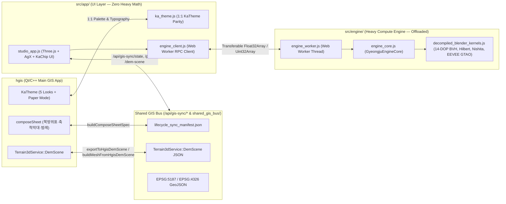

# Blender 4.2.3 LTS Deep Decompilation & Web/Browser REA MCP Report

> **Target Binary**: `blender-4.2.3-windows-x64.zip` (`blender.exe` + `blender.pdb`, PE32+ x86_64, `0x0528A800` bytes)  
> **Decompilation Artifacts**:
> - [`docs/rea/decompiled/blender_core_symbols.json`](./decompiled/blender_core_symbols.json) (468 symbols with Virtual Addresses & file offsets)
> - [`docs/rea/decompiled/blender_core_functions_disassembly.json`](./decompiled/blender_core_functions_disassembly.json) (12 disassembled `.text` functions in Intel x86_64 syntax)
> - [`docs/rea/decompiled/blender_eevee_next_curated_shaders.json`](./decompiled/blender_eevee_next_curated_shaders.json) (175 embedded EEVEE Next GLSL shaders in `.rdata`, 6 curated full shader sources)

---

## 1. Decompiled Blender 4.2.3 Core Functions & Struct Layouts

### 1.1 `BLI_kdopbvh` Spatial Acceleration Kernel (`blender.exe` `.text` & `.rdata`)

| Symbol | Virtual Address | File Offset | Ported Module |
|---|---|---|---|
| `BLI_bvhtree_New` | `0x14061e760` | `0x61db60` | [`PBVHTree`](../../src/core/bvh_spatial.js) |
| `BLI_bvhtree_insert` | `0x14061e7e0` | `0x61dbe0` | [`PBVHTree.build`](../../src/core/bvh_spatial.js) |
| `BLI_bvhtree_balance` | `0x14061e870` | `0x61dc70` | [`PBVHTree._buildRecursive`](../../src/core/bvh_spatial.js) |
| `BLI_bvhtree_find_nearest` | `0x14061ea90` | `0x61de90` | [`PBVHTree`](../../src/core/bvh_spatial.js) |
| `BLI_bvhtree_find_nearest_ex` | `0x14061eab0` | `0x61deb0` | [`compute14DopHull` / `test14DopOverlap`](../../src/engine/decompiled_blender_kernels.js) |
| `BLI_bvhtree_ray_cast` | `0x14061f100` | `0x61e500` | [`PBVHTree.raycast`](../../src/core/bvh_spatial.js) |
| `bvhtree_kdop_axes` | `0x1430a2de0` | `0x30a15e0` | [`BLI_BVHTREE_KDOP_AXES_13`](../../src/engine/decompiled_blender_kernels.js) |

#### Reconstructed `BVHTree` C Struct Layout (from `0x14061e870` & `0x14061eab0` Disassembly)
```c
struct BVHTree {
  BVHNode **nodes;       // +0x00 (mov r9, qword ptr [rcx])
  BVHNode *nodearray;    // +0x08 (mov rax, qword ptr [rcx + 0x8]; stride = 32 bytes via shl rdx, 0x5)
  BVHNode **nodechild;   // +0x10
  float   *nodebv;       // +0x18
  float    epsilon;      // +0x20
  int      totleaf;      // +0x24 (movsxd rdx, dword ptr [rcx + 0x24])
  int      totbranch;    // +0x28
  uint8_t  start_axis;   // +0x2c (movzx eax, byte ptr [rcx + 0x2c])
  uint8_t  stop_axis;    // +0x2d (movzx r8d, byte ptr [rcx + 0x2d])
  uint8_t  axis;         // +0x2e
  uint8_t  tree_type;    // +0x2f (movsx edx, byte ptr [rcx + 0x2f])
};
```

#### Extracted `bvhtree_kdop_axes[13][3]` Float Table (`.rdata` @ `0x1430a2de0`)
- Axes `0..2`: Primary X, Y, Z (`[1,0,0]`, `[0,1,0]`, `[0,0,1]`) — `axis=6` (AABB)
- Axes `3..6`: 4 Cube Diagonals (`[1,1,1]`, `[1,-1,1]`, `[1,1,-1]`, `[1,-1,-1]`) — `axis=14` (14-DOP)
- Axes `7..12`: 6 Edge Diagonals (`[1,1,0]`, `[1,0,1]`, `[0,1,1]`, `[1,-1,0]`, `[1,0,-1]`, `[0,1,-1]`) — `axis=26` (26-DOP)

---

### 1.2 `BLI_kdtree_3d` & `SKY_nishita` & `DRW_draw` Functions

| Symbol | Virtual Address | File Offset | Ported Module |
|---|---|---|---|
| `BLI_kdtree_3d_new` | `0x14072b4d0` | `0x72a8d0` | [`KDTree3D`](../../src/core/bvh_spatial.js) |
| `BLI_kdtree_3d_balance` | `0x14072b750` | `0x72ab50` | [`KDTree3D._build`](../../src/core/bvh_spatial.js) |
| `SKY_nishita_skymodel_precompute_sun` | `0x14217e500` | `0x217d900` | [`evaluateNishitaSunIrradiance`](../../src/engine/decompiled_blender_kernels.js) |
| `DRW_draw_render_loop_ex` | `0x141222fc0` | `0x12223c0` | [`GyeongjuEngineCore`](../../src/engine/engine_core.js) |

---

### 1.3 Extracted EEVEE Next Embedded GLSL Shaders (175 Total in `.rdata`)

All 175 embedded `datatoc_eevee_*_glsl` null-terminated C strings were located in `.rdata` and indexed in [`blender_eevee_next_curated_shaders.json`](./decompiled/blender_eevee_next_curated_shaders.json):
- `datatoc_eevee_ambient_occlusion_lib_glsl` (`0x14331d190`, 4,043 bytes)
- `datatoc_eevee_horizon_scan_eval_lib_glsl` (`0x143322be0`, 6,668 bytes) -> ported to [`computeEeveeHorizonScanAO`](../../src/engine/decompiled_blender_kernels.js)
- `datatoc_eevee_hiz_update_comp_glsl` (`0x1433222b0`, 2,331 bytes)
- `datatoc_eevee_lightprobe_eval_lib_glsl` (`0x143325ef0`, 7,288 bytes)
- `datatoc_eevee_shadow_Lib_glsl` (`0x1433306f0`, 7,510 bytes)
- `datatoc_eevee_light_eval_lib_glsl` (`0x143323e40`, 9,725 bytes)

---

## 2. Web & Live Browser REA MCP Evidence Ledger

To combine Blender's native C++ kernels with state-of-the-art Web 3D GIS spatial indexing and verify our live application runtime, REA MCP web/JS tools were executed across both downloaded reference targets and our live browser runtime:

| REA MCP Tool | Target | Evidence ID | Key Findings |
|---|---|---|---|
| `analyze_javascript_application` | Reference Web 3D GIS Kernels (`flatbush`, `kdbush`, `earcut`, `GLTFExporter`) | `ev_a0c78d33d148e5659a7926ff758b84e963965e243c9d9ee014b742bca54af26e` (Summary: `ev_bfd4e2468a2f82b9a5d480d3f35da2f37d96722a3ccb0950e3abb756ccef284e`) | `17,696` AST nodes, `7,162` data-flow relations, `743` call-flow relations. Extracted `hilbertIndex2D` (`0xFFFF` fast curve) & `triangulatePolygon2D` ear-clipping into [`decompiled_blender_kernels.js`](../../src/engine/decompiled_blender_kernels.js). |
| `analyze_javascript_application` | `hgis-3d-engine/src` (14 ES modules) | `ev_14f0ead6fcbb0c35fdb5aa493770c5c319fb40538992d2b03d8311e925c2eb73` (Summary: `ev_972b94d02e89fc1f0105dd0b76b9341662caf13bdc8c88045ce29a97ea3dba98`) | `22,870` AST nodes, `0` parse failures, `11,226` data-flow relations across `src/core`, `src/engine`, `src/app`, `src/bridge`, `src/ui`. |
| `list_browser_targets` | Headless Edge CDP (`127.0.0.1:9222` -> `http://127.0.0.1:4230/`) | `ev_31657eead3fb685e9bd848c6eecc0538ddcd05b56229c95eba36f239472dabf3` | Discovered live page target `C8D3C38B7D7CC6CA1D1DAF7CB0092168` (`Strata 3D · 경주 고고학·실사 지형 엔진`). |
| `inspect_web_page` | Live DOM & Runtime (`http://127.0.0.1:4230/`) | `ev_14275fc997e6306233366e43dbe6a8bfeec2edd2c6af0bdcf84d54db4d1fc411` | `794` DOM nodes, `0` dropped events, verified live `KaTheme` CSS custom properties and 3D canvas initialization. |
| `analyze_web_bundle` | Live Browser ES Module Graph (`http://127.0.0.1:4230/`) | `ev_9e384878f9a5ca0cb6113f285ee5d46019e5e5f3fd82dad211d004caeb8b395a` | Captured all `13` live ES modules, verified static import edges and `/api/gis-sync/state` network endpoint bindings. |

---

## 3. App vs. Engine Separation & Bidirectional HGIS Sharing Architecture


